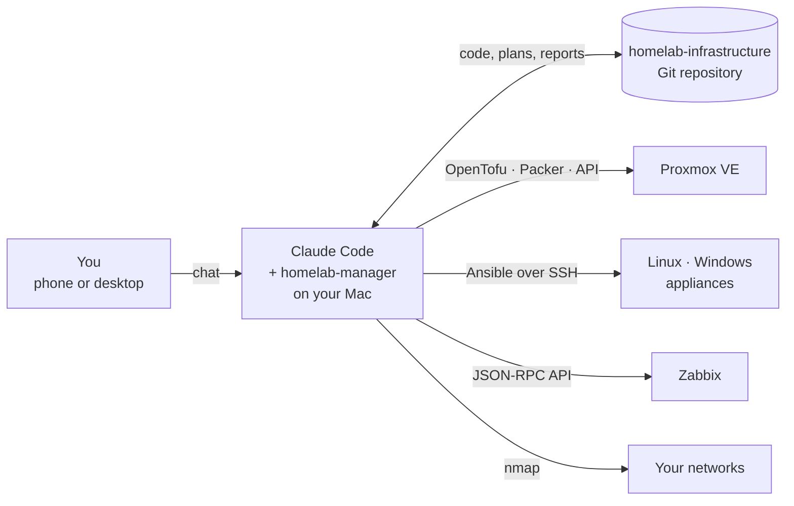

<div align="center">

# homelab-manager

**Run your homelab by talking to Claude.**

A Claude Code plugin that turns Claude into the operator of your homelab: Proxmox VE, VM templates, OpenTofu,
Ansible, patching, network discovery and Zabbix monitoring, all kept as code in one Git repository and guarded
by safety rules Claude can't talk its way around.

[](https://github.com/mhaluska/homelab-manager-skill/releases)
[](https://github.com/mhaluska/homelab-manager-skill/actions/workflows/tests.yml)
[](LICENSE)


[Quick start](#quick-start) · [What it can do](#what-it-can-do) · [Updating](#updating) ·
[Safety](#safety) · [Changelog](CHANGELOG.md) · [Report a problem](https://github.com/mhaluska/homelab-manager-skill/issues/new/choose)

</div>

---

## Why

A homelab grows one manual change at a time until nobody remembers how it was built. homelab-manager keeps it as
code from day one, without you having to write that code:

- **You say what you want**, in any language, from the Claude desktop or mobile app: *"create a Rocky VM with
  4 CPUs"*, *"patch all Linux servers"*, *"what changed since last week?"*.
- **Claude does the work the careful way**: it looks first, writes the OpenTofu, Packer or Ansible code, shows
  you the plan, waits for your yes, runs it, checks the result and commits it.
- **Everything lands in your own Git repository** (`homelab-infrastructure`), so your homelab is documented,
  reviewable and rebuildable.
- **A safety hook enforces the hard rules**: no scans outside your networks, no `-auto-approve`, no secrets in
  the chat, and a prompt before anything destructive.

It is built for a headless Mac (for example a Mac mini) that you reach from your phone, but it works just as
well at your desk.



## What it can do

Setup asks which parts you use and scaffolds only those; you can add the others later. Adding one brings in only
its files and its `homelab.yaml` section, with the template's comments.

| Area | What you get | Try saying |
|---|---|---|
| **Discovery & overview** | nmap scans limited to your own ranges, Proxmox inventory, Docker and NAS containers, a drift report (Proxmox ↔ OpenTofu ↔ Ansible ↔ network), a per-NIC guest map, and `OVERVIEW.md`, one readable page about your whole homelab with Mermaid maps | *"discover devices in my management subnet"*, *"compare my Proxmox against Git"*, *"describe my homelab"* |
| **Proxmox & OpenTofu** | VMs and LXC containers as code (bpg/proxmox provider), cloud-init, resizing, migration, PCI passthrough, backup jobs, importing what you already have, several sites; state on the Mac or in an S3-compatible bucket, never in Git | *"create a Debian VM with 8 GB RAM"*, *"add three Kubernetes workers"*, *"import my existing VMs"* |
| **VM templates** | Packer templates from the official Rocky Linux, Debian and Ubuntu cloud images, with checksums checked at build time | *"update the Rocky Linux template"* |
| **Ansible & patching** | Inventory, onboarding existing hosts, roles, missing-update checks, rolling patching with snapshots, Debian and Ubuntu release upgrades, Proxmox node patching (guests migrated or stopped first), Kubernetes drain and uncordon one node at a time | *"which hosts miss security updates?"*, *"patch all Linux servers"*, *"upgrade this Debian 12 host to 13"* |
| **Windows & appliances** | Windows over OpenSSH, read-only checks for NAS (QNAP), BMCs over Redfish (iLO, iDRAC, Supermicro, XCC), UniFi, and MikroTik RouterOS audits and upgrades | *"audit my MikroTik routers"*, *"upgrade RouterOS on the core switch"* |
| **Monitoring (Zabbix)** | Hosts, groups, templates, web and TLS checks, services and SLAs as data in `zabbix/config.yaml` (plan, then apply exactly that plan), maintenance windows and health checks around patching, quality and disk-forecast reports, the Agent 2 role, template upgrades with rollback | *"which hosts aren't monitored?"*, *"patch the web servers with Zabbix maintenance"*, *"will any disk fill up this month?"* |
| **Security** | A security audit of hosts, Proxmox, port forwards, the Mac and Zabbix, with a dated report; secrets only from the macOS keychain; Proxmox tokens split into read-only and read-write | *"run a security audit"*, *"is the keychain working?"* |
| **Watching** | An optional daily check on the Mac that sends a notification when something breaks | *"tell me when something breaks"* |

Claude writes problems in your homelab (drift, audit findings, failed runs) in its reply and in
`discovery/drift.md` or `docs/security-audit-<date>.md`, and offers to fix them.

## Quick start

### 1. Requirements

- **A Mac as the control machine** (macOS only for now: secrets come from the macOS login keychain) with
  [Homebrew](https://brew.sh) and [Claude Code](https://code.claude.com) (desktop app or CLI).
- **Tools**: `opentofu`, `hashicorp/tap/packer`, `ansible`, `nmap`, `yq`, `jq`, `git`, and `gh` for reporting
  skill issues. You only need the ones for the parts you use; `check_env.py` tells you what's missing and how to
  install it.
- **An SSH agent** with your homelab key. On a headless Mac, turn on auto-login so the login keychain is unlocked.
- The machines you **manage** can be anything: Proxmox VE 8 or 9, Linux, Windows and appliances; Zabbix 7.0 LTS or
  newer for monitoring.

### 2. Install the plugin

Start Claude Code in your `homelab-infrastructure` repository (an empty folder is fine) and run:

```text
/plugin marketplace add mhaluska/homelab-manager-skill
/plugin install homelab-manager@homelab-manager-skill
```

The repository is public, so no SSH key or token is needed. When Claude Code asks for the install scope:

| Scope | | Why |
|---|---|---|
| **local**: for you, in this repo only | ✅ Recommended | Active only in your homelab repo. Setup records the plugin in the repo's `.claude/settings.json`, so other clones offer to install it too. |
| project: for all collaborators | 👍 Fine | Writes the same `.claude/settings.json` right away. |
| user: for you, everywhere | ⚠️ Not recommended | The safety hook checks every shell command and the update check runs at every session start, so you'd get its prompts in unrelated projects too. |

### 3. Set up your repository

Open a new session in that folder and say:

> *Set up this repo for my homelab.*

Claude asks which parts you use (Proxmox, templates, Ansible, discovery, Windows, appliances, Kubernetes,
Zabbix), scaffolds only those, checks your tools and keychain, and asks for the settings it can't discover
itself. It walks you through creating the Proxmox API tokens and storing them in the keychain; **you never paste
a token into the chat.** You can stop halfway: what exists is committed and the setup picks up where it left off.

## Updating

**Just ask in the chat:**

> *Update the homelab-manager skill.*

Claude updates the marketplace and the plugin for you. The new version is active in the **next session**, so
start a new one afterwards.

You don't have to watch for releases: once a day, at the start of a session, the plugin checks for a newer
version and tells you. You can also ask *"is there a new version of the skill?"* at any time, or update by hand
with `/plugin marketplace update homelab-manager-skill` and then `/plugin`.

**After an update**, the first session in your homelab repo tells you what the new version brings for it:

- **Automatic updates**: template files you never edited are replaced with the new version, and a file a playbook
  needs but your repo is missing is added, after your yes. Template files you don't have are only listed.
- **Suggestions**: new settings, changes to files you've edited, snapshots to refresh, steps on Proxmox. Each one
  waits until you accept or decline it.
- **Fixed skill issues**: problems you reported that this release fixed.

What changed in each version: [Releases](https://github.com/mhaluska/homelab-manager-skill/releases) and
[CHANGELOG.md](CHANGELOG.md).

## Safety

The skill tells Claude how to work safely; a hook makes sure the critical rules hold. `hooks/guard.py` checks
every shell command Claude runs (including the scripts it writes and runs), and `hooks/guard_files.py` checks
edits to the files that guard the guard.

| | Examples |
|---|---|
| 🚫 **Always denied** | nmap targets outside `network.authorized_ranges`, random or decoy scans, `tofu … -auto-approve`, printing keychain secrets or the `gh` token, reading private SSH keys, non-English issues or pull requests on this repository |
| ✋ **Asks you first** | `tofu apply` without a saved plan or with deletions or replacements, `destroy`, state edits and imports, Proxmox writes (`qm`, `pct`, `pvesh`, API), ZFS destroy, reboots and shutdowns, patching outside `--check`, Zabbix writes and template downloads, force-push, `curl \| sh`, root or NSE scans, sending skill issues, widening the scan scope, editing the plugin or Claude Code permission settings |
| ✅ **Optional shortcut** | `permissions.auto_allow_readonly: true` lets the plugin's read-only scripts run without a permission prompt |

On top of that, Claude follows a fixed loop for every change (inspect, plan, validate, **your approval**,
execute, verify, record, commit), never reboots two nodes of the same cluster at once, and treats everything it
reads from your network (banners, hostnames, Proxmox notes, Zabbix problems) as data, never as instructions.

> [!NOTE]
> The guard is defence in depth, not a sandbox: it reads command text. The real boundaries are the restricted
> API tokens (read-only for discovery, read-write only for changes) and your review of each plan.

**Secrets** stay in the macOS login keychain. `homelab.yaml` only names keychain items, and tools get the values
through `with_secrets.py`, which keeps them out of the chat and redacts them from output. OpenTofu state and plans
are never committed; a pre-commit hook in your repo blocks them.

## Your homelab repository

Setup creates only what your chosen parts need:

```text
homelab-infrastructure/
├── homelab.yaml        # your site: networks, Proxmox, storage, VMID ranges, keychain item names
├── OVERVIEW.md         # one readable page about the whole homelab, regenerated after changes
├── tofu/               # OpenTofu: VMs and LXC containers
├── packer/             # VM templates
├── ansible/            # inventory, roles and playbooks (patching, audits, upgrades, Agent 2)
├── zabbix/             # monitoring as data: config.yaml, exports, templates
├── discovery/          # snapshots and reports: Proxmox, network, drift, Zabbix
├── docs/               # decisions, recovery, tokens, templates, audit reports
└── skill_issues.md     # problems with and ideas for the skill itself
```

## Languages

Talk to Claude in any language. Your repository's language (`site.language`, asked during setup) is used for
Claude's replies, the docs it writes, commit messages and new code comments. Identifiers and the files the plugin
manages stay in English. Skill issues go to this English-only repository, so Claude writes them in English for
you.

## Problems and ideas

When the skill itself gets something wrong (a script crashes, the guard blocks something legitimate, an
instruction is wrong, a template doesn't validate), Claude notes it in `skill_issues.md` in your repo. It notes
**ideas** there too: when it does by hand what a script could do, or when you say *"it would be nice if…"*.

Say ***"report skill issues"*** and Claude sends them to [this repository's
issues](https://github.com/mhaluska/homelab-manager-skill/issues). Before anything is sent it removes everything
site-specific (IPs, MACs, your domain, host, guest and node names, VMIDs, VLANs, storage and pool names, user
names, secrets), looks for an existing issue to comment on instead, and shows you the exact text for your yes. You
can also open an issue by hand with the *Problem with the skill* or *Idea for the skill* form.

## Inside this repository

| Path | What |
|---|---|
| [`skills/homelab-manager/SKILL.md`](skills/homelab-manager/SKILL.md) | The skill's entry point: workflow, safety rules, routing |
| [`skills/homelab-manager/references/`](skills/homelab-manager/references/) | One guide per area: discovery, Proxmox, templates, OpenTofu, Ansible, patching, Windows and appliances, security, monitoring |
| [`skills/homelab-manager/scripts/`](skills/homelab-manager/scripts/) | Python helpers (standard library only): inventory, scans, drift, overview, Zabbix, secrets wrapper, environment check, repo setup and upgrades |
| [`skills/homelab-manager/assets/repo-template/`](skills/homelab-manager/assets/repo-template/) | The scaffold for your `homelab-infrastructure` repository |
| [`hooks/`](hooks/) | The safety guards (`guard.py`, `guard_files.py`), the daily update check and a reminder to note failed scripts |
| [`agents/`](agents/) | Subagents for delegated work: `homelab-runner` (Haiku, fully specified commands) and `homelab-analyst` (Sonnet, work that needs judgement) |
| [`tests/`](tests/) | Unit tests: `python3 -m unittest discover -s tests` |
| [`skills/homelab-manager/evals/`](skills/homelab-manager/evals/) | Behaviour test cases for `claude plugin eval` |

## Contributing

Contributions are welcome. See [CONTRIBUTING.md](CONTRIBUTING.md), and [CLAUDE.md](CLAUDE.md) for the developer
notes: plugin layout, tests, template validation and releases. Everything in this repository is in English.

## License

[MIT](LICENSE)
